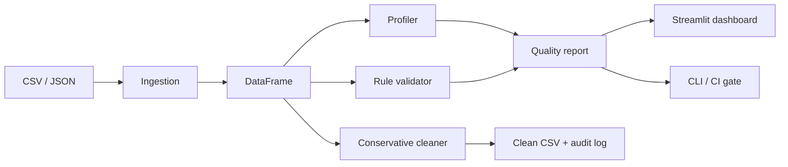

# DataGuard

DataGuard is a lightweight, explainable data-quality platform for CSV and JSON datasets. It helps analysts and engineers find missing, duplicate, and invalid data; understand a transparent quality score; apply conservative cleaning steps; and export the result.

> **Status:** Portfolio-ready MVP. The core analysis engine, dashboard, CLI, tests, CI, sample data, and container setup are implemented.

## Why this project exists

Bad data quietly breaks dashboards, machine-learning features, and business decisions. DataGuard turns common quality checks into a repeatable workflow that is useful locally and easy to integrate into a pipeline.

## Features

- CSV and JSON ingestion
- Missing-value and exact-duplicate detection
- Column rules for type, required values, and uniqueness
- Email, date, numeric, integer, boolean, and text validation
- Explainable 0–100 quality score across completeness, uniqueness, and validity
- Safe cleaning with a human-readable audit log
- Cleaned CSV download
- Streamlit dashboard and automation-friendly CLI
- Unit tests, linting, GitHub Actions, and Docker support

## Architecture



The UI is deliberately separate from the domain logic. `src/dataguard` can be tested or called without Streamlit, while `app.py` focuses on interaction and presentation.

## Quick start

Requirements: Python 3.11 or newer.

```bash
python -m venv .venv
source .venv/bin/activate
python -m pip install -e ".[dev]"
streamlit run app.py
```

Open the local URL shown by Streamlit, then upload a dataset or select **Load sample dataset**.

### Run from the command line

```bash
dataguard data/sample_customers.csv
dataguard data/sample_customers.csv --fail-below 90
```

The second command exits with status 1 when the score is below the threshold, making it suitable for a CI data-quality gate.

### Run with Docker

```bash
docker build -t dataguard .
docker run --rm -p 8501:8501 dataguard
```

## Quality score

DataGuard keeps scoring simple enough to explain in an interview:

| Dimension | Weight | Calculation |
| --- | ---: | --- |
| Completeness | 40% | Non-missing cells / all cells |
| Uniqueness | 25% | Non-duplicate rows / all rows |
| Validity | 35% | Rule-valid cells / all cells |

The weighted result is bounded from 0 to 100. The report also preserves each component score so a user can see *why* the result changed.

## Project structure

```text
.
├── app.py                     # Streamlit presentation layer
├── data/                      # Safe sample dataset
├── src/dataguard/
│   ├── analyzer.py            # Profiling and scoring
│   ├── cleaner.py             # Cleaning operations + audit log
│   ├── cli.py                 # Pipeline-friendly command
│   ├── io.py                  # CSV/JSON adapters
│   ├── models.py              # Typed domain models
│   └── validators.py          # Vectorized rule checks
├── tests/                     # Unit tests
├── .github/workflows/ci.yml   # Automated lint and test workflow
└── Dockerfile
```

## Development

```bash
make install
make lint
make test
```

## Build plan

### Milestone 1 — MVP (complete)

- Ingestion, automated profiling, scoring, cleaning, export
- Single-column interactive validation rule
- CLI, tests, CI, Docker, and documentation

### Milestone 2 — Strong portfolio release

- Save and load multi-column schema contracts from YAML
- Add numeric ranges and allowed-value controls to the dashboard
- Produce downloadable JSON and HTML reports
- Add Playwright smoke tests and dashboard screenshots to this README
- Deploy a public demo using a free hosting tier

### Milestone 3 — Data engineering depth

- Persist run metadata and quality trends in PostgreSQL
- Schedule checks and compare datasets across runs
- Add Great Expectations or Pandera interoperability
- Emit alerts and expose a REST API
- Process large inputs in chunks or with Polars/DuckDB

## Interview talking points

- The scoring model favors completeness but keeps each dimension visible and explainable.
- Cleaning is opt-in, operates on a copy, and returns an audit trail.
- Business logic is isolated from the UI for testing and reuse.
- The CLI can enforce a quality threshold inside CI/CD or an ETL pipeline.
- Future scale paths are explicit instead of hidden behind premature complexity.

## Contributing

Create a branch, add tests for behavior changes, run `make lint test`, and open a focused pull request. Never commit private or production datasets; use synthetic fixtures.

## License

MIT

